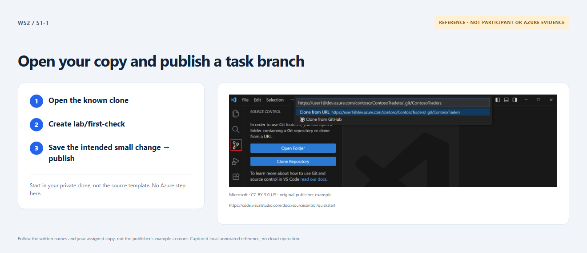

# Section 1 · Step 1 — Push your first check

**Do** After AgentAlvine's start receipt in your Exercise, reuse/open your assigned clone; otherwise copy the private repository's Code → HTTPS URL, then choose VS Code → Source Control → Clone Repository → paste → Open. Create `lab/first-check`. In [exercise/participant.json](../../exercise/participant.json), change only `app_message` from `Hello from alex` to `Ready for checks`. Save, inspect the diff, stage, commit and Publish Branch.

**How / why** This meaningful post-start push is the first gate, not installation/sign-in evidence. Use your individual Enterprise SSO/MFA account; follow [setup](../../docs/start-here.md) beforehand.

_Reference preview: branch/input task, not participant execution or live proof. [Notice](../../docs/images/NOTICE.md)._

**Expected** Your actual current task-branch push is observed in the same Exercise. Keep this clone/branch for Section 2; no additional tool or chat evidence is required.

**Fix** Wrong repository/folder? Correct access first; never push the source template.
