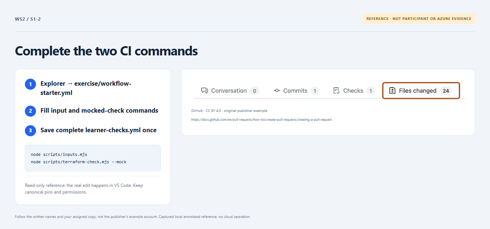

# Section 1 · Step 2 — Install the checks workflow

**Do** On the same branch, open the [starter buffer](../../exercise/workflow-starter.yml) and [complete reference](../../exercise/validation-workflow.yml). Fill the starter's two `run` gaps with `node scripts/inputs.mjs` and `node scripts/terraform-check.mjs --mock`. In VS Code Explorer → New File, create `.github/workflows/learner-checks.yml`. Save the completed reference body there, without the starter's introductory comments. Commit and push.

**How / why** The event/header is supplied. Preserve `push`, `pull_request`, read-only permissions, action pins and indentation. The installed body must exactly match the complete reference, including its final newline.

_Reference preview: workflow buffers, not participant execution or live proof. [Notice](../../docs/images/NOTICE.md)._

**Expected** One complete credential-free Learner checks workflow is installed.

**Fix** Compare files in VS Code; do not alter the reference or guards.
