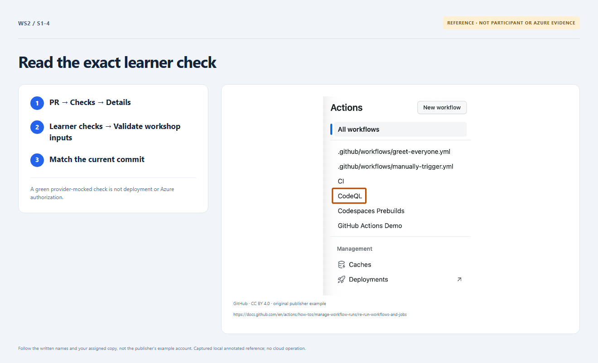

# Section 1 · Step 4 — Inspect current checks

**Do** Open your PR → Checks → Learner checks → Validate workshop inputs. Match the latest branch commit; expand Validate participant input and the backend-free mocked infrastructure step. Read the actual results, including nonzero mocked test counts.

**How / why** Current credential-free CI validates inputs and Terraform contracts, not installation, Azure permissions or deployment. An older green revision or skipped job is insufficient.

_Reference preview: checks guidance, not participant execution or live proof. [Notice](../../docs/images/NOTICE.md)._

**Expected** Actual required checks succeed. Retain the same clone, branch and open PR for Section 2. At verified 4/4, AgentAlvine pauses with this lesson visible. Only after its ready prompt, comment `proceed to next section` in the same Exercise.

**Fix** Repair the current input/workflow using [recovery](../../docs/recovery.md); never weaken checks. Early comments are not queued. Ordinary copies remain live-pending.
