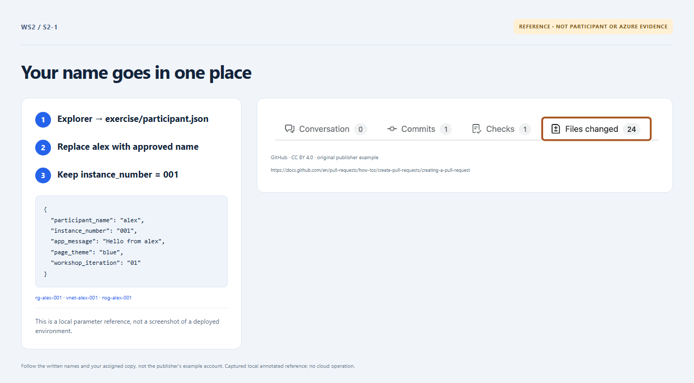

# Section 2 · Step 1 — Choose approved inputs

**Do** After [owner readiness](../../docs/instructor-setup.md), read [parameters](../../docs/parameters.md). In [exercise/participant.json](../../exercise/participant.json), replace `alex` with your approved name/alias: 2–12 lowercase letters/digits, starting with a letter. Keep five fields as strings: fixed `instance_number` `001`, your `participant_name`, message `Hello from <name>`, theme `blue`, iteration `01`. Save, commit and push on the same task branch.

**How / why** One name derives `rg-<name>-001`, `app-<name>-001` and storage `st<name>001`; storage has no hyphens. No hidden hash changes these names.

_Reference preview: input/name mapping, not participant execution or live proof. [Notice](../../docs/images/NOTICE.md)._

**Expected** The owner reserved the name, verified global app/storage availability and confirmed the target RG is absent—not precreated. Freeze name/`001` before first apply.

**Fix** Unknown fields/types or conflicts must be corrected before deployment; never import, overwrite or self-grant permissions.
