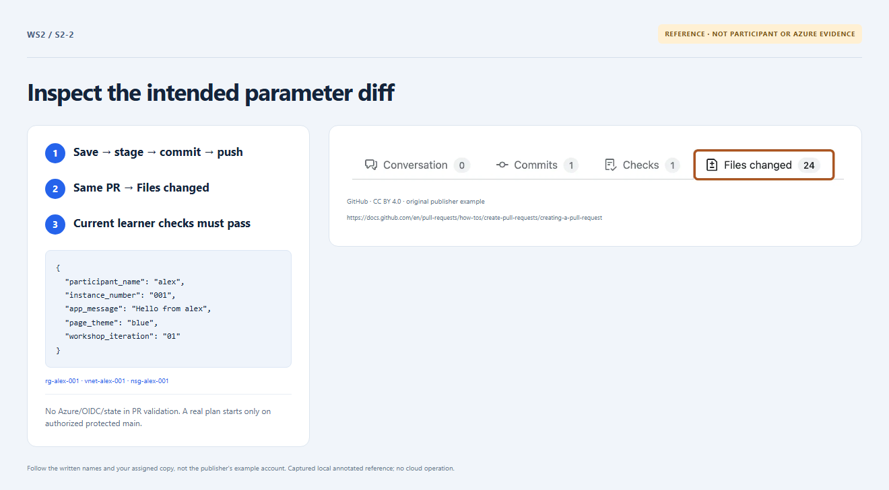

# Section 2 · Step 2 — Inspect your input PR

**Do** Keep the same PR. Inspect Files changed and current Learner checks → Validate workshop inputs; match the commit and five strings from Step 1.

**Copilot 2/3 — optional: generate → review IaC.** Attach [name mapping](../../infra/locals.tf) and [the supplied RG](../../infra/resource-group.tf) in read-only Chat. Ask: “Generate the existing Terraform RG using local.names.resource_group, var.assignment.location and local.tags. HCL only; no file/tool actions. Explain each reference.”

**Fallback — no Copilot needed.** This is the expected block already supplied; compare it, **do not add a duplicate or edit the protected blueprint**:

```hcl
resource "azurerm_resource_group" "workshop" {
  name     = local.names.resource_group
  location = var.assignment.location
  tags     = local.tags
}
```

**How / why** This small generation/review technique connects participant inputs to IaC. The existing blueprint already builds the environment; only the parameter file changes. PR CI is not a live plan. [Parameter rules](../../docs/parameters.md) remain authoritative.


_Reference preview: PR/input inspection, not participant execution or live proof. [Notice](../../docs/images/NOTICE.md)._

**Expected** Current input checks pass; keep the PR open until permitted to merge. No Copilot response is graded.

**Fix** Skip unavailable/incorrect Chat and use the block/checklist. Never change guards, roles, SKU or backend; an offline dev PR needs owner handoff, not retargeting.
