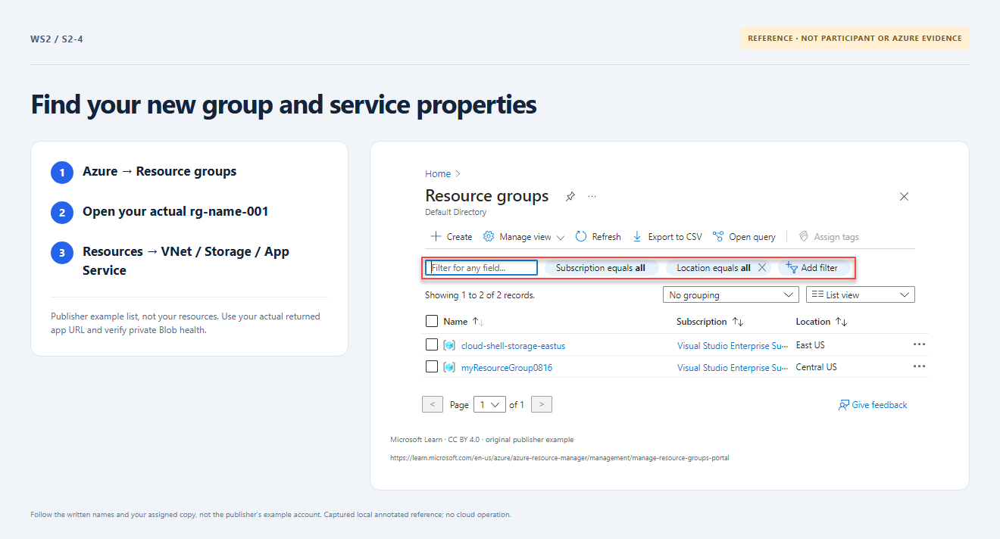

# Section 2 · Step 4 — Inspect your environment

**Do** Open Verify deployed workshop in the same run. In Azure, select the approved subscription → Resource groups → `rg-<name>-001` → Resources. Compare the [architecture](../../docs/architecture.md), then open the returned `app_url` from the approved network. Use Check private storage.

**How / why** Actual ARM topology and `/healthz` plus `/health/storage` HTTP 200 verify the managed-identity private-Blob path, not just page appearance.

_Reference preview: environment/page inspection, not participant execution or live proof. [Notice](../../docs/images/NOTICE.md)._

**Expected** Actual verification confirms Linux B1/one worker, StorageV2/LRS/Hot and private Blob, whichever authoring path you used. Retain this run/receipt and input as Section 3's baseline. At verified 4/4, pause with this lesson visible; after the ready prompt, comment `proceed to next section` in the same Exercise.

**Fix** Missing/failed checks stay pending. Ask the owner; never edit the portal to conceal differences. B1 bills while idle/stopped.
