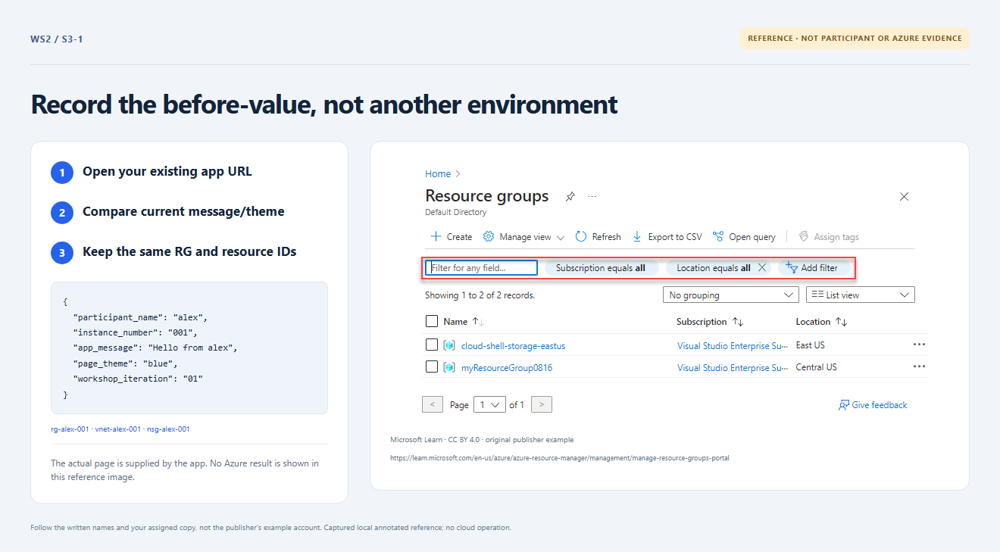

# Section 3 · Step 1 — Read your baseline

**Do** After Section 2's ready prompt/transition, open the preceding `s2-4` receipt and its delivery revision → Browse files. Compare [participant input](../../exercise/participant.json), page, RG and tags. Retain the same clone/root/state and privately recorded RG/VNet/app/storage IDs.

**Copilot 1/3 — optional: reason before changing.** Attach only the supplied [name mapping](../../infra/locals.tf) and [parameter rules](../../docs/parameters.md). Ask read-only Chat: “Explain which input values must stay fixed for an in-place update and why iteration 02 does not rename 001. No edits or commands yet.” Keep actual IDs/state out of Chat.

**Fallback — no Copilot needed.** Keep your approved `participant_name` and string `instance_number` `001` fixed. Later change only message/theme/iteration, after the next step's recorded rejection. Keep all Terraform, workflow, owner and state configuration unchanged.

**How / why** The prior receipt locates the baseline; it is not a fresh Azure probe. Stable IDs distinguish update from replacement.

_Reference preview: baseline comparison, not participant execution or live proof. [Notice](../../docs/images/NOTICE.md)._

**Expected** The first deployment matches the baseline. No Copilot output is required.

**Fix** Skip unavailable/incorrect Chat; read the fallback. Missing/wrong RG or receipt still requires [recovery](../../docs/recovery.md), never another environment or recreated names.
