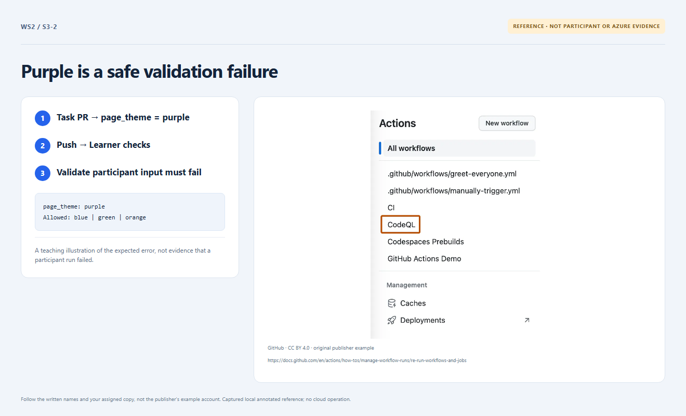

# Section 3 · Step 2 — Observe intended rejection

**Do** From verified `main` in the same clone, create `lab/theme-update`. Change only `page_theme` to `purple` in [exercise/participant.json](../../exercise/participant.json). Commit, push and open a nondraft PR to protected `main`. Inspect Learner checks → Validate workshop inputs → Validate participant input. Wait for AgentAlvine's rejection receipt before correcting it.

**How / why** `purple` is intentionally unsupported. The unchanged input validator must reject it before Azure access; a green quality job alone is not this evidence.

_Reference preview: rejection guidance, not participant execution or live proof. [Notice](../../docs/images/NOTICE.md)._

**Expected** That exact input step fails for the theme allowlist; merge remains blocked, with no Azure job.

**Fix** Setup/YAML errors or unrelated failures do not count. Repair those without changing validators, permissions or guards; never deploy `purple`.
