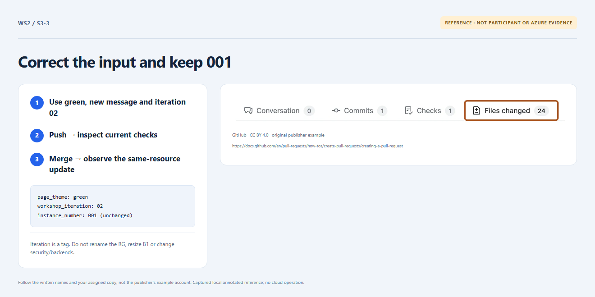

# Section 3 · Step 3 — Deploy the correction

**Do** Only after the rejection receipt, correct the same PR's [participant input](../../exercise/participant.json).

**Copilot 3/3 — optional: minimal patch → review → test.** Attach the participant file and [rules](../../docs/parameters.md). Ask read-only Chat: “Return JSON changing only theme to green, message to Updated by my existing name and iteration to 02. Preserve name/001; no extra fields, edits or commands.” Review every proposed change.

**Fallback — no Copilot needed.** Copy the full expected fix, replacing both `<name>` placeholders with your **unchanged baseline name**:

```json
{
	"participant_name": "<name>",
	"instance_number": "001",
	"app_message": "Updated by <name>",
	"page_theme": "green",
	"workshop_iteration": "02"
}
```

**How / why** Either path changes only three fields, not Terraform/names. Review the diff; run `npm run check:inputs`; commit/push. Inspect green current checks, merge to protected `main` when permitted and open its fresh delivery run. Iteration 02 never means suffix 002.


_Reference preview: update input, not participant execution or live proof. [Notice](../../docs/images/NOTICE.md)._

**Expected** Fresh plan/apply/package succeeds with zero creates/deletes/replacements; name/001 and IDs remain unchanged.

**Fix** Skip unavailable/incorrect Chat and paste the fix. Unrelated edits or unexpected actions stay blocked; ask the owner, never portal-edit or weaken checks.
