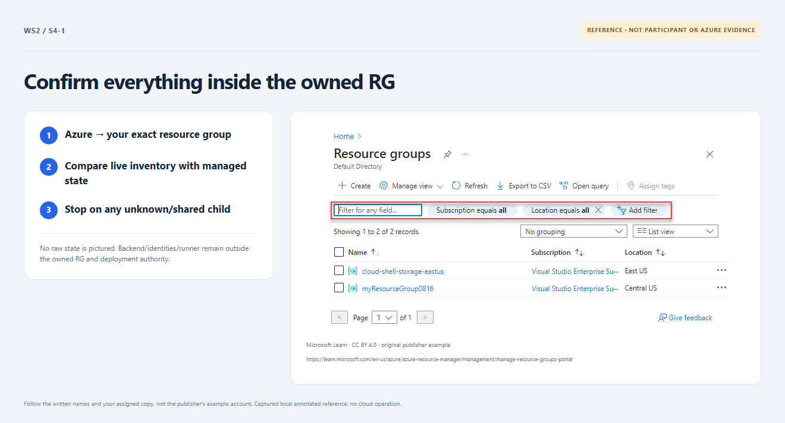

# Section 4 · Step 1 — Confirm owned inventory

**Do** Continue from Section 3's corrected input and preceding `s3-4` receipt in the same Exercise. Open that update run. Compare Azure → approved subscription → `rg-<name>-001` → Resources with the approved inventory. Have the owner reconcile children against the same owning root and locked managed state; never publish raw state.

**How / why** RG deletion can remove untracked children. Its receipt locates prior verification, not a fresh inventory; cleanup rechecks actual inventory. See [cleanup readiness](../../docs/instructor-setup.md).

_Reference preview: ownership boundary, not participant execution or live proof. [Notice](../../docs/images/NOTICE.md)._

**Expected** Only state-owned resources and correlated platform children exist. Backend, UAMI, runner and shared infrastructure remain outside the RG and deployment authority.

**Fix** Unknown/unrelated objects, ownership gaps or another state stop cleanup; never infer ownership from names alone.
