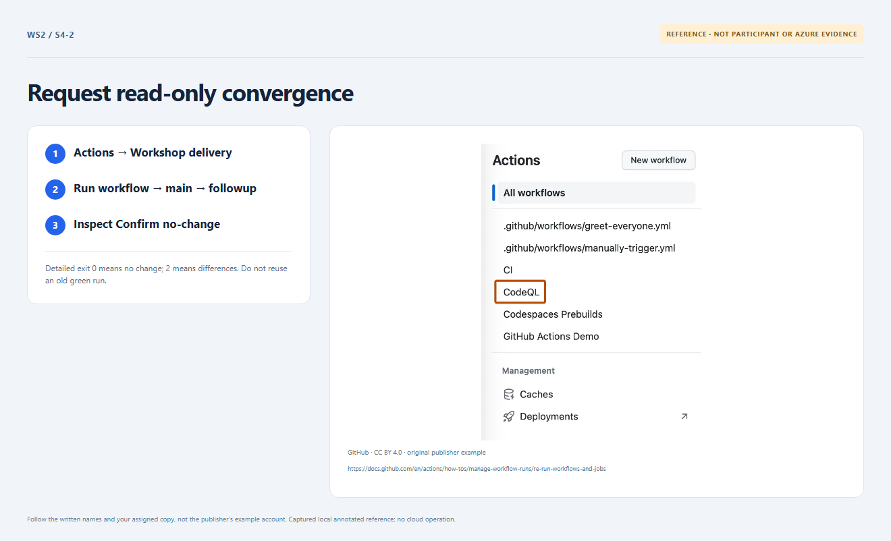

# Section 4 · Step 2 — Confirm fresh no-change

**Do** With the same updated revision on protected `main`, choose Actions → Workshop delivery → Run workflow → branch `main` → operation `followup`. Inspect its Confirm no-change job and fresh Terraform results. Retain the same root, owner profile and state binding.

**How / why** Native detailed exit `0` means convergence; `2` means differences and `1` means error. This dispatch never applies changes or performs cleanup. See [recovery](../../docs/recovery.md).

_Reference preview: followup guidance, not participant execution or live proof. [Notice](../../docs/images/NOTICE.md)._

**Expected** Actual current-run Confirm no-change succeeds with zero changes against the Section 3 update, not a reused receipt, generated explanation or echoed output.

**Fix** Missing readiness, moved `main`, drift or skipped checks remain pending. Ask the owner; never force an apply, unlock shared state or treat mocks as convergence.
