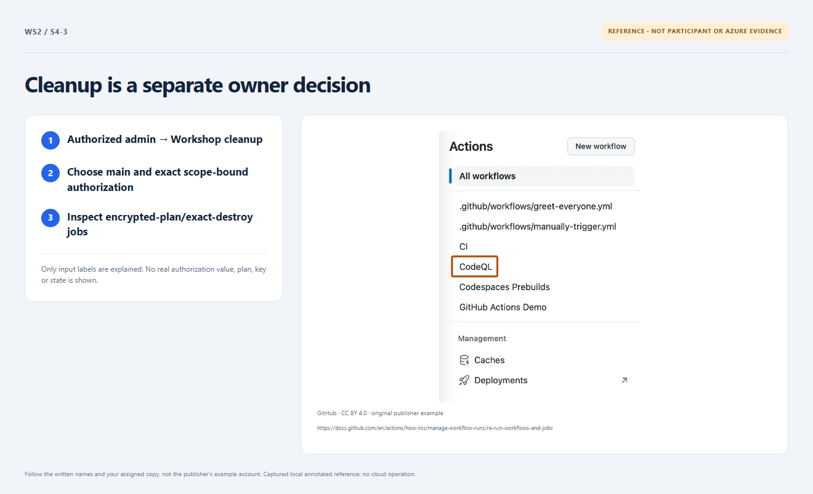

# Section 4 · Step 3 — Authorize separate cleanup

**Do** The separately authorized current repository admin selects Actions → Workshop cleanup → Run workflow → `main`, privately supplying `destroy:<repoID>:<currentfullmainSHA>:<WS2_STATE_LOCK_ID>`. Reconfirm exact subscription/RG/inventory: no unknown/shared objects. Never publish authorization values.

**How / why** Actual jobs are Create encrypted workshop plan and Apply exact workshop plan. Their destroy-specific steps are Create encrypted workshop destroy plan and Apply exact authorized workshop destroy plan. The full authenticated same-run saved destroy plan removes children before the Terraform-owned RG, last.

_Reference preview: cleanup contract, not participant execution or live proof. [Notice](../../docs/images/NOTICE.md)._

**Expected** Only the exact owning root/state/revision verified in the prior steps is destroyed. Normal pushes/comments and authoring suggestions never destroy.

**Fix** Inventory mismatch, locks or nonempty-RG rejection? Stop for the [owner](../../docs/instructor-setup.md); never force-delete, target resources, weaken safeguards or expose plans/state/keys.
