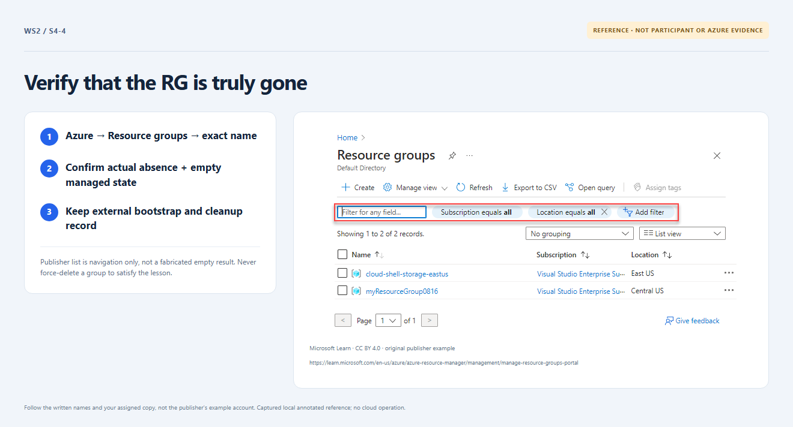

# Section 4 · Step 4 — Verify absence and retention

**Do** In the same cleanup run, inspect Verify workload absence: require exact known-RG ARM `404 ResourceGroupNotFound` plus empty Terraform-managed workload state. Azure → approved subscription → Resource groups must show `rg-<name>-001` absent, not empty. Have the owner verify retained backend, UAMI, runner/shared infrastructure and reconcile bootstrap grants.

**How / why** Failed web access or green apply alone cannot prove deletion. Retained bootstrap remains outside deployment authority and may still incur costs.

_Reference preview: absence criteria, not participant execution or live proof. [Notice](../../docs/images/NOTICE.md)._

**Expected** Either authoring path reaches the same 16/16 only through genuine absence evidence. The full final lesson stays visible after completion/closure; no fourth boundary comment or separate authoring evidence is needed.

**Fix** Uncertain deletion stays open/pending. Escalate through [recovery](../../docs/recovery.md); never delete backend/identity/runner or award completion from mocks.
