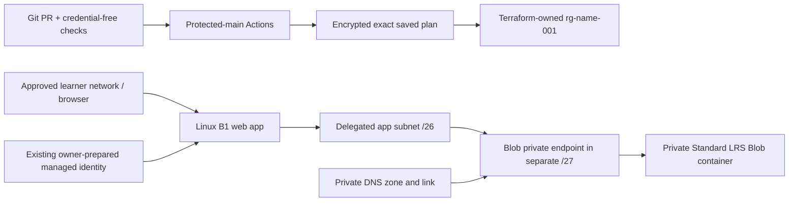

# Small, connected and deliberately bounded

The learner changes a name, message/theme and iteration in one JSON file.
Readable HCL is split into [RG](../infra/resource-group.tf),
[network](../infra/network.tf), [storage](../infra/storage.tf) and
[web](../infra/web.tf). [Locals](../infra/locals.tf) derive names and tags;
[variables](../infra/variables.tf) reject invalid values. The supplied
[app](../app/server.mjs) displays settings and performs a real read-only Blob listing.

- **Basic B1, Linux, one instance** is the smallest Basic choice for this regional
  VNet-integrated design. Free F1 does not support this integration. B1 bills while
  idle/stopped; delete the plan during authorized cleanup.
- **StorageV2/Standard/LRS/Hot**, no anonymous/shared-key/public data access. Workload
  storage is **not** remote-state storage. App traffic resolves the normal Blob
  hostname to the private endpoint; a successful empty listing is enough.
- App integration is **outbound**, not private inbound hosting. Web/SCM HTTPS
  ingress is restricted to the owner-assigned CIDR, default Deny. If policy requires
  private web ingress, this profile stays blocked until a separately reviewed
  endpoint/DNS/learner+SCM access design exists; no public-access workaround.
- The NSG retains Azure default rules; this is **not a zero-trust egress firewall**.
  Private traffic uses the VNet; other startup traffic is not forced into an
  unprovisioned NAT/firewall path.
- The app identity/data grant, backend, OIDC, runner and shared access infrastructure
  remain **outside the owned RG and deployment authority**. Different names or
  backend keys alone do not prove isolation.

No database, VM, NAT gateway, registry, custom domain or new monitoring stack is
needed. Organization-required security/telemetry still applies and is priced.
The example owner assignment is fake/offline, never deployment authorization.

References: [App Service VNet integration](https://learn.microsoft.com/en-us/azure/app-service/overview-vnet-integration),
[storage private endpoints](https://learn.microsoft.com/en-us/azure/storage/common/storage-private-endpoints),
[Azure names](https://learn.microsoft.com/en-us/azure/azure-resource-manager/management/resource-name-rules).
