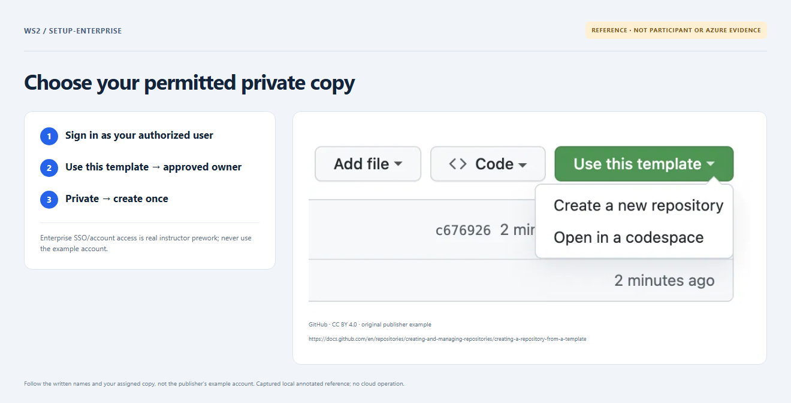
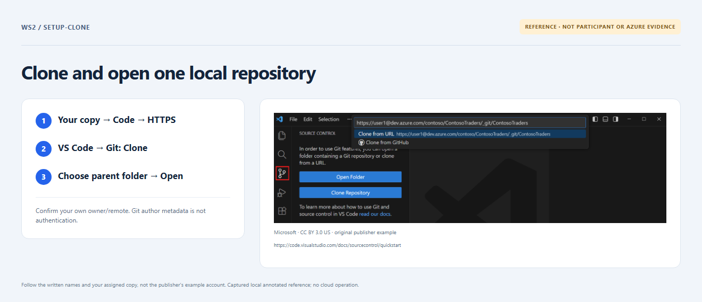

# Start here — one private copy, one local clone

## Before the timer: accounts and tools

Use **your own authorized GitHub Enterprise Cloud user**, not a shared admin.
The instructor confirms whether your organization uses personal accounts plus SSO
or Enterprise Managed Users from its IdP. Complete its required SSO/MFA and accept
the repository invitation. This implementation targets **github.com**; other
Enterprise hosts/Server need a reviewed compatibility/federation change.

Install from official sources: [Git](https://git-scm.com/downloads),
[desktop VS Code](https://code.visualstudio.com/Download),
[Node.js 24](https://nodejs.org/en/download) (workshop pin **24.16.0**),
[Terraform 1.16.1](https://releases.hashicorp.com/terraform/1.16.1/) and the
[HashiCorp Terraform extension](https://marketplace.visualstudio.com/items?itemName=HashiCorp.terraform).
Use the signed installers/normal OS verification. Do not disable TLS, replace
global PATH or loosen a machine execution policy. Reopen VS Code after installing.
Copilot is optional. Azure CLI is **not needed** for offline checks or Actions OIDC.

The instructor provides a **private copy** in the permitted Enterprise organization
and enrolls your immutable user ID(s). Where policy allows you to copy, choose
**Use this template → Create a new repository → approved organization → Private**.
Do not fork, use a ZIP as the working clone, create another copy for each section,
or change `main`/protections. An ordinary private copy is **offline only**.



*REFERENCE navigation, not proof of your sign-in. [Attribution](images/NOTICE.md).*

## Clone once

In **your private copy**, use **Code → HTTPS**, copy the credential-free URL and
check its owner/name. In desktop VS Code use **Ctrl+Shift+P → Git: Clone → paste
that URL → choose a parent directory → Open**. macOS uses **Cmd**. Trust only
the known clone, not its parent. Complete only browser/Git authentication you
initiated; never paste tokens, device codes or passwords into chat/issues.



*REFERENCE navigation. Publisher example accounts/paths are not yours.*

## Check the clone

Open **Terminal → New Terminal** at this clone's root. Run one line at a time;
stop on failure. Windows PowerShell can use **npm.cmd** if its npm script wrapper
is blocked—no execution-policy change is required.

```text
git remote -v
node --version
terraform version
npm ci --ignore-scripts
npm ci --prefix app --omit=dev --ignore-scripts
node scripts/doctor.mjs
```

- `git remote -v` shows your private copy, not this source. Commit author name/email
  are metadata, **not authentication**. Preserve existing settings; if missing,
  use your approved name/verified or noreply email **clone-locally**, not globally.
- The version commands confirm the pins. `npm ci` installs locked dependencies;
  `--ignore-scripts` prevents package lifecycle scripts. Registry access is required.
- The doctor only reads local readiness; it cannot certify SSO, Git write access,
  Azure, budget, roles or private networking. See [recovery](recovery.md) on failure.

Now open **Issues → Exercise**. Missing enrollment/startup? Ask the instructor;
do not manufacture another Exercise, tick completion or dispatch cloud workflows.
The same issue shows one current step, then pauses at 4/4 until you comment
**`proceed to next section`**. [Complete reference](../full-ws-content/README.md).
