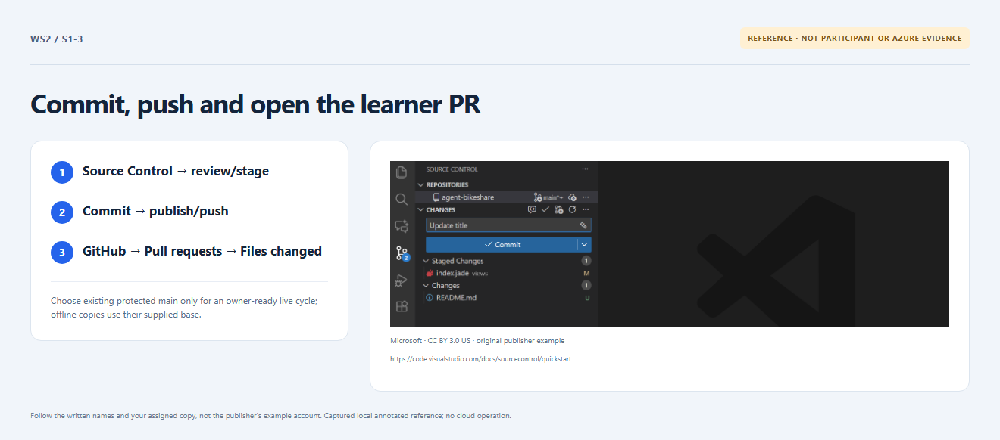

# Section 1 · Step 3 — Open your learner PR

**Do** In your repository, choose Pull requests → New pull request. Compare `lab/first-check` with the existing protected `main` only when the owner prepared it before this live course cycle. Otherwise, use your offline copy's default `dev`. Inspect Files changed; create a nondraft PR and leave it open.

**How / why** A real same-repository PR exposes the current learner revision. Retargeting an old offline PR later cannot manufacture protected-main course history.

_Reference preview: PR navigation, not participant execution or live proof. [Notice](../docs/images/NOTICE.md)._

**Expected** An open PR records the actual base and intended input/workflow changes. Section 2 reuses this PR; do not merge it yet.

**Fix** Missing prepared `main`? Complete Section 1 offline, then hand off for a reviewed cycle/restart. Never create an unprotected shortcut or require self-approval.
