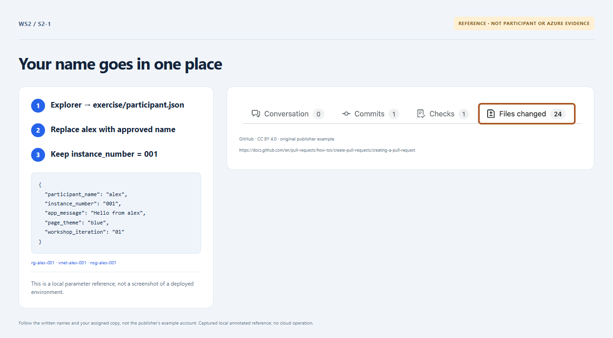

# Section 2 · Step 1 — Choose approved inputs

**Do** Continue the same Section 1 branch/PR after [owner readiness](../docs/instructor-setup.md). Read [parameters and the Copilot routine](../docs/parameters.md#copilot-techniques--sections-2-and-3-only). Edit only [exercise/participant.json](../exercise/participant.json).

**Copilot 1/3 — optional: context → constrained generation.** In read-only Chat, attach the participant file and parameters. Ask: “Return five-string JSON for my approved name, fixed 001, Hello from my name, blue, 01. No extra fields or file/tool actions.” Review the proposed values.

**Fallback — no Copilot needed.** Copy this complete expected input; replace both `<name>` placeholders with your approved lowercase name/alias, not literally the brackets:

```json
{
	"participant_name": "<name>",
	"instance_number": "001",
	"app_message": "Hello from <name>",
	"page_theme": "blue",
	"workshop_iteration": "01"
}
```

**How / why** Either path produces the same file. Review the diff, run `npm run check:inputs`, then commit/push. Names derive from name/001; storage omits hyphens.


_Reference preview: input/name mapping, not participant execution or live proof. [Notice](../docs/images/NOTICE.md)._

**Expected** The owner reserved the name, checked global app/storage availability and confirmed the RG is absent. Freeze name/001 before first apply.

**Fix** Missing/slow/incorrect Copilot? Use the fallback immediately; no chat evidence is required. Invalid values still need correction; never import, overwrite or self-grant.
