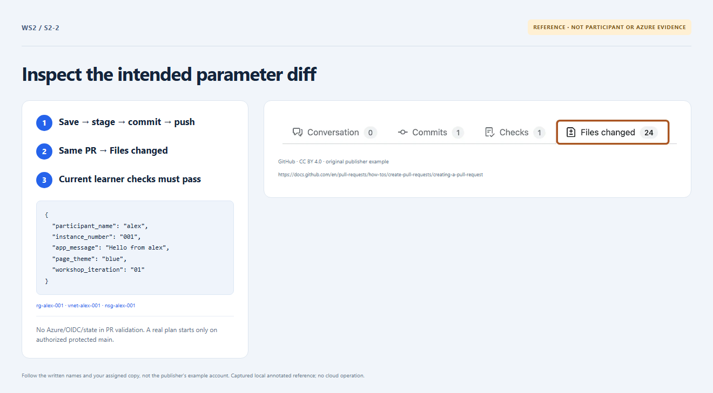

# Section 2 · Step 2 — Inspect your input PR

**Do** Return to the same Section 1 PR. Inspect the latest participant diff in Files changed, then Checks → Learner checks → Validate workshop inputs. Match its commit to your pushed input; confirm the chosen name, fixed `001` and intended message/theme/iteration.

**How / why** PR inspection is a source diff plus credential-free CI, not a live Azure plan. Keep installed checks unchanged; [parameters](../docs/parameters.md) explains valid values and rejected overrides.

_Reference preview: PR/input inspection, not participant execution or live proof. [Notice](../docs/images/NOTICE.md)._

**Expected** Current-revision input checks succeed without Azure access. Keep the recorded PR open until permitted to merge.

**Fix** Repair values, not eligibility, allowlists, roles, SKU, backend or bypass settings. An offline `dev` PR needs owner handoff/reviewed restart, not historical retargeting.
