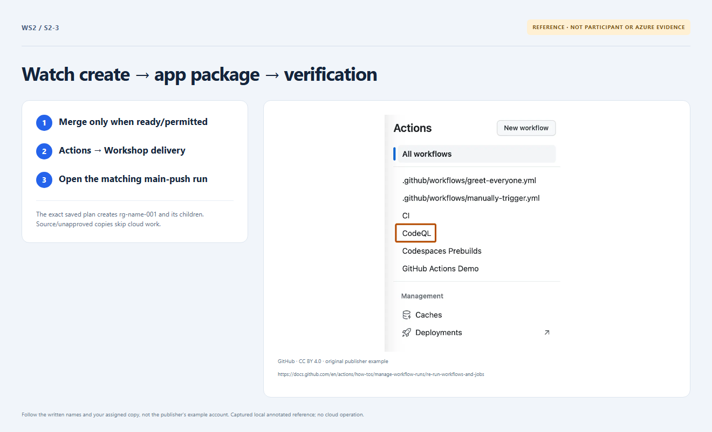

# Section 2 · Step 3 — Observe real delivery

**Do** After required checks and owner readiness pass, merge the recorded PR into existing protected `main`; its author may merge. Open Actions → Workshop delivery at that exact merge revision. Inspect Create encrypted workshop plan, Apply exact workshop plan and Package and deploy workshop app.

**How / why** Main validation precedes scoped OIDC, locked state, encrypted planning and exact saved-plan apply. Terraform creates the RG before children; the pipeline deploys the same-revision ZIP. No separate deployment approver/button.

_Reference preview: delivery sequence, not participant execution or live proof. [Notice](../docs/images/NOTICE.md)._

**Expected** Real current-run jobs succeed; inspect safe counts/hashes, never raw plans/state or tokens.

**Fix** Skipped/disabled jobs are pending, not success. Missing creation, bootstrap or runner permission belongs to the [owner](../docs/instructor-setup.md); never bypass it.
