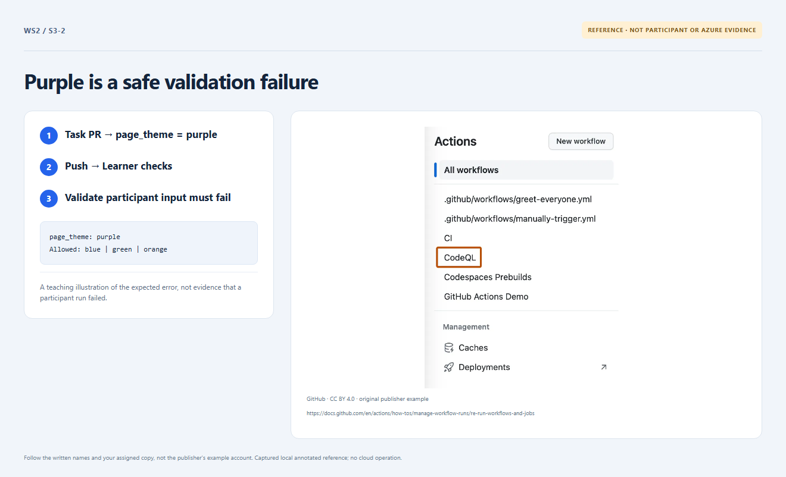

# Section 3 · Step 2 — Observe intended rejection

**Do** From verified `main`, create `lab/theme-update`. In [exercise/participant.json](../exercise/participant.json), replace only the existing theme line with this intentional negative case; retain every other field:

```json
  "page_theme": "purple",
```

Commit/push and open a nondraft PR to protected `main`. Inspect Learner checks → Validate workshop inputs → Validate participant input. Wait for AgentAlvine's rejection receipt **before fixing**.

**Copilot 2/3 — optional: diagnose a precise failure.** Give read-only Chat the participant file, [allowed values](../docs/parameters.md) and only the sanitized error “page_theme must be blue, green or orange”. Ask: “Explain this expected rejection and the minimal future correction; do not edit files or run commands.”

**Fallback — no Copilot needed.** Purple is unsupported; the expected diagnosis is the theme allowlist, not Azure permissions. The next step supplies the full green fix. Do not copy the single-line fragment as an entire JSON file.

**How / why** Real unchanged learner validation must fail before Azure; green Workshop quality alone is insufficient.


_Reference preview: rejection guidance, not participant execution or live proof. [Notice](../docs/images/NOTICE.md)._

**Expected** The named input step rejects purple; no merge/Azure job. No AI diagnosis is graded.

**Fix** Skip unavailable Chat. Unrelated/YAML errors do not count; repair without changing validators/guards. Never deploy purple.
