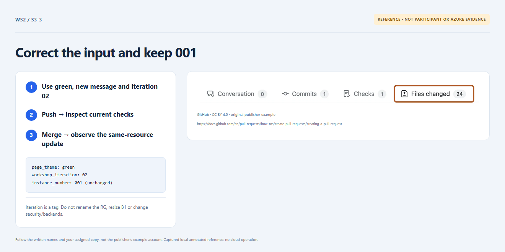

# Section 3 · Step 3 — Deploy the correction

**Do** After the rejection receipt, edit the same PR's [participant input](../exercise/participant.json): `page_theme` `green`, `app_message` `Updated by <name>` using your chosen name, and `workshop_iteration` `02`. Keep `participant_name` and `instance_number` `001` unchanged. Commit/push, inspect current green required checks, then merge into protected `main` when permitted. Open its fresh Workshop delivery run.

**How / why** Iteration `02` updates settings/tags, not the resource-name suffix. The exact saved plan must preserve existing identities while the same-revision app package is deployed.

_Reference preview: update input, not participant execution or live proof. [Notice](../docs/images/NOTICE.md)._

**Expected** Fresh plan/apply/package checks succeed with zero creates, deletes or replacements; `rg-<name>-001` remains unchanged.

**Fix** Renaming, `001` → `002`, stale runs or unexpected actions stay blocked. Ask the owner; never change resources in the portal.
