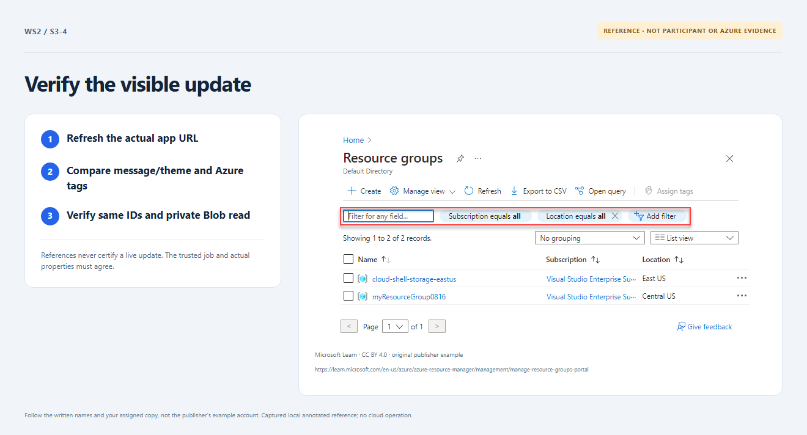

# Section 3 · Step 4 — Verify unchanged identities

**Do** Open Verify deployed workshop in that same update run. After workflow package activation/restart, refresh the returned app URL from the approved network. Compare the page, Azure `workshop_iteration` tags and your baseline RG/VNet/app/storage IDs; check `/healthz` and `/health/storage` HTTP 200 results.

**How / why** Expect `Updated by <name>`, green and iteration `02`, with unchanged names/IDs. Local previews/older runs are not fresh private-Blob evidence.

_Reference preview: updated page, not participant execution or live proof. [Notice](../docs/images/NOTICE.md)._

**Expected** Real same-run verification passes regardless of authoring path. Keep the corrected input, IDs and this run/receipt for Section 4. At verified 4/4, pause with this lesson visible; after the ready prompt, comment `proceed to next section` in the same Exercise.

**Fix** Stale page, wrong IDs or failed Blob access stays pending; use [recovery](../docs/recovery.md), not portal edits or another environment.
